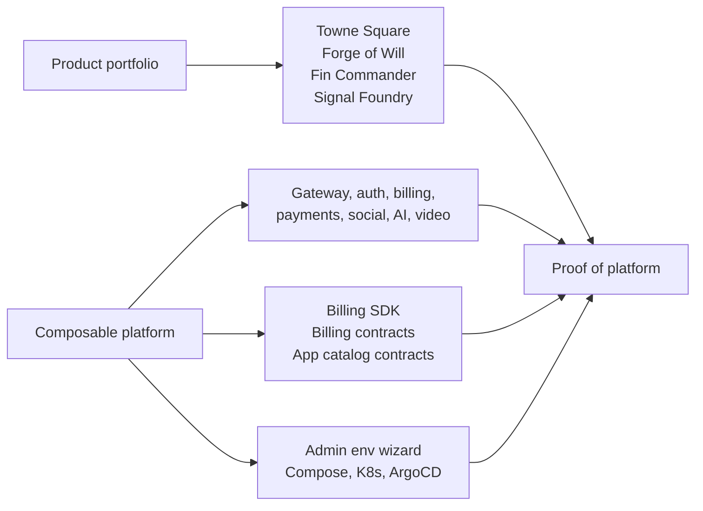

# Marketing Documentation

This section contains internal positioning notes for people evaluating products, the platform underneath them, or the developer package surface. It is not approved public launch copy. RR-01 owns OT/TS claim dispositions; the release owner must reconcile those claims with the accepted RR-12 revision before promotion. A repo source, route, or test is not by itself acceptance evidence.

## Start Here

| Audience                             | Read this first                                                    | Use it to understand                                                  |
| ------------------------------------ | ------------------------------------------------------------------ | --------------------------------------------------------------------- |
| external evaluator                   | [Repo Story](./repo-story.md)                                      | the whole portfolio-platform-proof narrative                          |
| product buyer or operator            | [Platform Product Matrix](./platform-product-matrix.md)            | which product fits which audience and workflow                        |
| community or local-commerce operator | [Towne Square](./towne-square.md)                                  | local coordination and early-access classifieds                       |
| execution-focused team               | [Forge of Will](./forge-of-will.md)                                | project delivery, risks, journals, timers, and context                |
| finance workflow evaluator           | [Fin Commander](./fin-commander.md)                                | guided setup, scoped plans, imports, and scenarios                    |
| marketer or launch team              | [Signal Foundry](./signal-foundry.md)                              | campaign briefs, concepts, materials, exports, and refinement history |
| developer                            | [npm Developer Packages](./npm-developer-packages.md)              | current package surfaces and mirror-release posture                   |
| platform or ops team                 | [Admin Environment Wizard Demo Script](./admin-env-demo-script.md) | generated deployment from catalog selection to live gateway           |

## Visual Story

## Product One-Pagers

- [Towne Square](./towne-square.md) records place-centered positioning and early-access local exchange; it is not release approval.
- [Forge of Will](./forge-of-will.md) frames the focused project-execution surface.
- [Fin Commander](./fin-commander.md) frames the guided financial-workflow surface.
- [Signal Foundry](./signal-foundry.md) frames the marketing campaign workbench and the clearest proof-of-platform case study.

The one-pagers are internal working material. Check their claims against RR-01 and the accepted RR-12 set before adapting them for external use.

## Core Messaging Reference

- [Messaging Pillars](./messaging-pillars.md) is a positioning draft. It does not override RR-01 or release evidence and must not be used as ground truth for outward-facing claims.

## Platform And Developer Materials

- [Repo Story](./repo-story.md) connects the products, service layer, deployment tooling, and package path into one pitch.
- [Platform Product Matrix](./platform-product-matrix.md) compares the main marketed surfaces by audience, workflow, billing posture, deployment posture, and maturity.
- [npm Developer Packages](./npm-developer-packages.md) explains the current public package surface and release path.
- [Admin Environment Wizard Demo Script](./admin-env-demo-script.md) gives an ops-oriented walkthrough from generated deployment output to a live gateway contract.
- [Service Offerings](./service-offerings.md), [Library Offerings](./library-offerings.md), and [Pricing Models](./pricing-models.md) capture current packaging vocabulary and constraints.
- [Design System: Personalities](../design-system/personalities.md) catalogs the 12 personalities, the canonical product mapping, and the distinctiveness matrix used by the theme system.

## Agent Prompts For Generating Marketing Materials

These prompts live in `.github/prompts/` and can be used with any AI agent that supports prompt files. Each prompt loads supporting material and provides output structure and tone guidance. Supporting material is not claim approval.

| Prompt                                    | Use it to                                                                                                          |
| ----------------------------------------- | ------------------------------------------------------------------------------------------------------------------ |
| `generate-product-landing-copy.prompt.md` | Write landing page hero copy, feature highlights, and CTAs for any product                                         |
| `generate-social-posts.prompt.md`         | Write Twitter/X, LinkedIn, and Mastodon post sets per product or theme                                             |
| `generate-email-campaign.prompt.md`       | Write announcement, nurture, onboarding, or developer email sequences                                              |
| `generate-developer-pitch.prompt.md`      | Write SDK getting-started guides, README sections, blog posts, and API overviews                                   |
| `generate-platform-pitch.prompt.md`       | Write pitch deck narratives, one-pagers, capabilities briefs, and demo scripts for operator and platform audiences |

These prompts are drafting aids only. Do not treat marketing documents or repository source presence as claim approval. Any OT/TS public claim must map to RR-01's disposition and, where required, an accepted owning journey and the RR-12 reviewed revision. Do not generate or distribute launch material while RR-12 is unaccepted.

## Current Boundaries

- Public pricing language is posture and vocabulary, not a published commercial price sheet.
- Public npm publication depends on the mirror-repo workflow; source development remains in this monorepo.
- Hosted demos and public API references should not be implied unless those external surfaces are deployed.
- Product claims should map to RR-01 and its named behavior owner. READMEs, service docs, deployment docs, package metadata, and tests can help locate evidence; they do not establish user-facing acceptance on their own.
- Keep Daylight and civic-feed claims out unless RR-07 accepts the relevant behavior. General local coordination, commerce, and civic participation may remain product direction when clearly distinguished from a released civic feed.
- Keep funding, donations, sponsorships, transaction/payment promises, business tiers, featured placement, and analytics out of released-product claims under RR-01 and DF-002. Do not imply that settled locality or core access depends on donations.
- Do not claim reputation-driven moderation, moderation guarantees, or community ownership/trust guarantees. RR-01 withdraws those claims; DF-001 retains the broader feature as deferred.
- Email delivery is a shared configured capability, not an unresolved per-app setting. RR-13 has not established the current invitation flow's end-to-end delivery; the reviewed invitation path is broken, so do not promise that invitations are sent or received.
